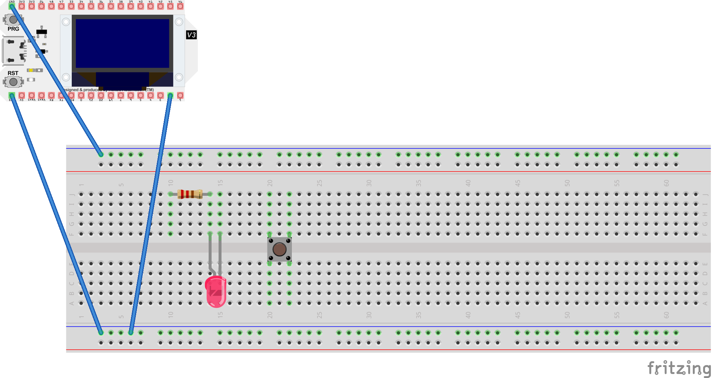

# BÁO CÁO THỰC HÀNH BUỔI 3 (TH3)
**Môn học:** Thí nghiệm Khoa học Kỹ thuật 2 (AET2022)  
**Sinh viên thực hiện:** Phạm Minh Hoàng  
**Mã sinh viên:** 25112214  
**Thiết bị:** Heltec ESP32-S3 WiFi Kit V3  

---

## 1. MÃ NGUỒN VÀ BÀI TẬP

### **Bài 1: Wi-Fi Access Point (AP) và Station (STA)**
- **Nội dung:** Chạy 2 chế độ Wi-Fi cơ bản của ESP32.
  - `vd1_access_point.cpp`: ESP32 tự phát mạng Wi-Fi `ESP32_AP_Nhom25112214` với IP mặc định `192.168.4.1`.
  - `vd2_station.cpp`: ESP32 kết nối vào Wi-Fi AP và nhận địa chỉ IP từ DHCP.
- **Kết quả quan sát:** Điện thoại/laptop quét thấy SSID của ESP32; Serial Monitor in đúng địa chỉ IP khi kết nối thành công.

### **Bài 2: BLE Server (Bluetooth Low Energy)**
- **Nội dung:** Khởi tạo BLE Server tạo Service và Characteristic chứa chuỗi thông tin sinh viên (`MSV: 25112214 - Pham Minh Hoang`).
- **Kết quả quan sát:** Sử dụng ứng dụng **nRF Connect** quét thấy thiết bị BLE, kết nối thành công và đọc/ghi được đặc tính thông qua UUID.

### **Bài 3: Giao thức ESP-NOW (Truyền nhận trực tiếp giữa 2 Kit)**
- **Nội dung:** 
  - `vd1_transmitter.cpp`: Đọc MAC của Receiver và truyền gói dữ liệu struct định kỳ 2 giây.
  - `vd2_receiver.cpp`: Đăng ký callback `onRecv` để nhận dữ liệu và in ra Serial Monitor.
- **Kết quả quan sát:** Receiver nhận đúng gói tin đếm tăng dần trực tiếp theo địa chỉ MAC mà không qua router.

### **Bài 4: HTTP Web Server Điều khiển LED**
- **Nội dung:** Dựng WebServer cổng 80 với các route `/`, `/toggle`, `/on`, `/off` điều khiển LED chân GPIO2.
- **Sơ đồ:** Sử dụng lại sơ đồ phần cứng TH1 (LED - GPIO2).

*(Ghi chú: Mã nguồn thiết kế Fritzing gốc `ffritzingb1.fzz` và `bai_2.fzz` đã được đính kèm trong thư mục `fritzing/` của repo này).*
- **Kết quả quan sát:** Mở IP của ESP32 từ trình duyệt di động/PC cùng mạng, bấm các nút trên giao diện web để bật/tắt LED ngay tức thì.

### **Bài 5: MQTT Publish/Subscribe**
- **Nội dung:** ESP32 kết nối Wi-Fi và trỏ tới Broker `test.mosquitto.org:1883`.
  - **Publish:** Gửi số đếm tăng dần lên topic `bcse/th3/nhom-25112214/count`.
  - **Subscribe:** Đăng ký topic `bcse/th3/nhom-25112214/led` nhận lệnh `'1'` (Bật LED) và `'0'` (Tắt LED).
- **Kết quả quan sát:** App MQTT Client nhận dữ liệu liên tục và có thể gửi lệnh điều khiển LED từ xa.

---

## 2. HÌNH ẢNH / VIDEO MINH CHỨNG THỰC TẾ

*Hình minh chứng: Ứng dụng nRF Connect quét và đọc đặc tính BLE từ ESP32.*

---

## 3. TRẢ LỜI CÂU HỎI ÔN TẬP VẤN ĐÁP (SLIDE 29)

1. **Phân biệt hai vai AP và STA của ESP32 – khi nào dùng cái nào?**
   - **Station (STA):** ESP32 đóng vai trò là client nối vào một Access Point có sẵn (như router Wi-Fi gia đình). Dùng khi cần kết nối Internet, truy cập dịch vụ cloud hoặc giao tiếp với thiết bị khác trong mạng LAN.
   - **Access Point (AP):** ESP32 tự đóng vai trò là trạm phát Wi-Fi cho các thiết bị khác (điện thoại, laptop) kết nối vào. Dùng khi thiết lập cấu hình ban đầu, hoặc khi hoạt động độc lập ở nơi không có router Wi-Fi.

2. **BLE trao đổi dữ liệu qua đâu? Vai trò của UUID dịch vụ/đặc tính là gì?**
   - BLE trao đổi dữ liệu qua cấu trúc **GATT (Generic Attribute Profile)** gồm các Dịch vụ (Service) và Đặc tính (Characteristic).
   - **UUID (Universally Unique Identifier):** Là định danh duy nhất 128-bit giúp Client phân biệt chính xác dịch vụ nào và thuộc tính/đặc tính nào cần đọc hoặc ghi dữ liệu.

3. **ESP-NOW khác Wi-Fi thường ở điểm nào? Vì sao nó không cần router?**
   - ESP-NOW sử dụng khung truyền không dây tầm ngắn của Espressif ở tầng MAC (Data Link layer).
   - Dữ liệu được đóng gói gửi trực tiếp theo địa chỉ MAC 6-byte của chip nhận mà không cần qua thủ tục bắt tay (handshake) hay cấp phát IP từ Router. Do đó nó có độ trễ cực thấp và không tốn năng lượng duy trì kết nối.

4. **Trong HTTP, client và server trao đổi theo mô hình nào? GET khác POST ra sao?**
   - HTTP trao đổi theo mô hình **Hỏi - Đáp (Request / Response)**. Client gửi yêu cầu, Server trả về kết quả.
   - **GET:** Dùng để yêu cầu lấy dữ liệu từ server. Tham số được truyền trực tiếp trên URL.
   - **POST:** Dùng để gửi dữ liệu từ client lên server để xử lý. Dữ liệu được đóng gói trong phần thân (Body) của request nên bảo mật và chứa được lượng dữ liệu lớn hơn GET.

5. **MQTT dùng mô hình publish/subscribe - broker và topic đóng vai trò gì?**
   - **Broker:** Là máy chủ trung gian tiếp nhận tất cả tin nhắn, quản lý kết nối và phân phối tin nhắn đến đúng các thiết bị đăng ký.
   - **Topic:** Là đường dẫn chuỗi đóng vai trò làm địa chỉ/chủ đề để phân loại dữ liệu. Publisher gửi tin vào Topic, Subscriber đăng ký Topic đó để nhận tin.

6. **Lựa chọn giao thức phù hợp cho 3 trường hợp:**
   - *(a) Điều khiển từ điện thoại ở gần:* **BLE** (tiết kiệm pin, kết nối thẳng không cần mạng).
   - *(b) Hai cảm biến gửi nhanh cho nhau:* **ESP-NOW** (độ trễ siêu thấp, không cần router, gửi tức thì).
   - *(c) Gửi dữ liệu lên nhiều thiết bị qua mạng:* **MQTT** (mô hình pub/sub qua Broker giúp truyền tin cậy tới hàng ngàn thiết bị cùng lúc).